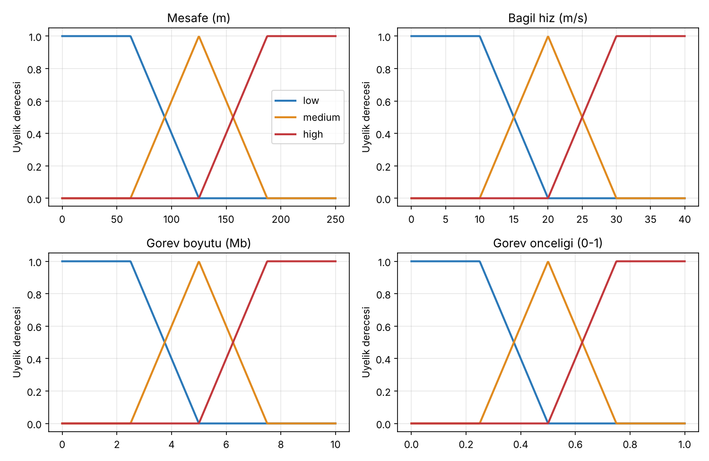
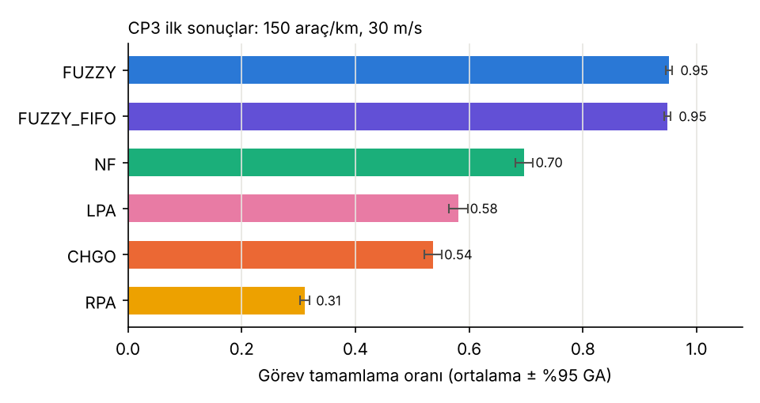
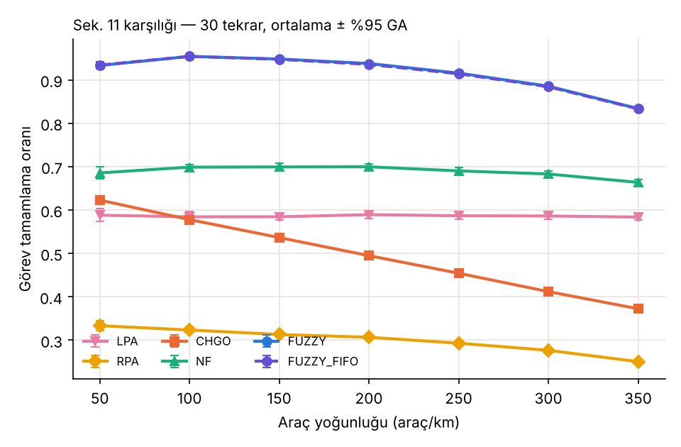
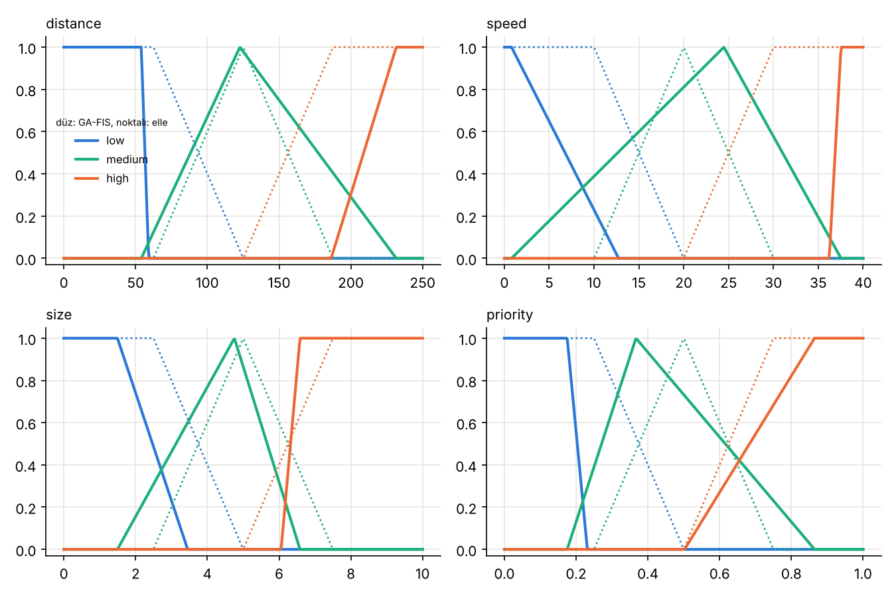
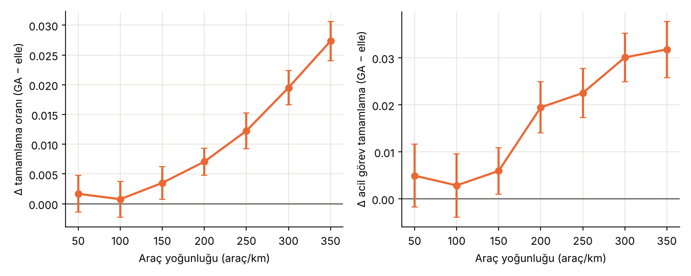

# Fuzzy-Based Task Offloading in IoV Edge Computing — Reproduction & GA-Tuned Extension

> Bulanık Mantık Dersi Dönem Projesi

## Student Information
- **Ad Soyad:** Ahmet Sadık Altıner
- **Ders:** Bulanık Mantık

## Original Paper
Z. Trabelsi, M. Ali, and T. Qayyum, "Fuzzy-based task offloading in Internet of Vehicles (IoV) edge computing for latency-sensitive applications," *Internet of Things*, vol. 28, Art. no. 101392, 2024. doi: [10.1016/j.iot.2024.101392](https://doi.org/10.1016/j.iot.2024.101392)

## Problem Description
Araçların işlem kaynakları kısıtlıdır, bu yüzden görevler V2V ile komşu araçlara (edge node) aktarılır. Ancak yüksek hareketlilik bağlantıları kısa ömürlü yapar ve görevlerin aciliyeti birbirinden farklıdır. Referans çalışma iki adımlı bir çözüm öneriyor: (i) bağlantı süresini ve kaynağı dikkate alan bir edge seçimi, (ii) edge düğümünde bulanık mantıkla görev önceliklendirme.

## Method
Bulanık sistem şu şekilde kurgulandı:
- **Girdiler:** mesafe, bağıl hız, görev boyutu, görev önceliği. Her biri 3 terimli (low/medium/high).
- **Çıktı:** öncelik skoru (0–100). Edge kuyruğu bu skora göre sıralanır.
- **Çıkarım:** Mamdani (min/max), centroid durulaştırma, 81 kural.

Ayrıntılar: [`docs/01_makale_analizi.md`](docs/01_makale_analizi.md) ve [`docs/03_uygulama_plani.md`](docs/03_uygulama_plani.md).

## Fuzzy System Architecture
```
Beacon (konum, hız, MIPS) ──► Edge seçimi (Denk. 3–9) ──► Görev EN'ye gönderilir
                                                          │
           mesafe, hız, boyut, öncelik ──► Bulanıklaştırma ──► 81 kural (Mamdani)
                                                          ──► Birleştirme ──► Centroid ──► Skor ──► Öncelik kuyruğu
```


## Dataset
Referans çalışma simülasyon tabanlıdır (Veins + SUMO) ve veri paylaşılmamıştır. Bu projede veri, Python simülatörü tarafından tohum (seed) kontrollü olarak üretilir. Makaledeki grafiklerden sayısallaştırılan değerler `data/paper_digitized/` klasöründe tutulur.

## Installation
```bash
git clone https://github.com/<kullanici>/fuzzy-iov-offloading.git
cd fuzzy-iov-offloading
python -m venv .venv
source .venv/bin/activate        # Windows: .venv\Scripts\activate
pip install -r requirements.txt
```

## Requirements
Python ≥ 3.10. Gerekli paketler `requirements.txt` dosyasında.

## How to Run
```bash
python -m src.fuzzy.fis                                   # FIS'i örnek girdilerle çalıştır, kuralları yazdır
python -m src.fuzzy.plot_fis                              # MF ve kontrol yüzeyi grafiklerini üret
python -m pytest -q                                       # 40 test (FIS doğrulaması, simülatör, GA)
python -m experiments.baseline.cp3_first_results          # tek senaryo, 6 yöntem, 10 seed (~10 s)
python -m experiments.baseline.run_sweep --exp density --reps 30   # E1: Şek. 9 ve 11
python -m experiments.baseline.run_sweep --exp speed   --reps 30   # E2: Şek. 12
python -m experiments.baseline.compare_with_paper --reps 30        # makaleyle karşılaştırma tabloları
python -m src.fuzzy.ga_tuning --pop 16 --gens 12 --tag ga_pilot    # GA-FIS (MF optimizasyonu)
python -m experiments.proposed.ga_pilot_holdout --tag ga_pilot     # GA-FIS'i test seed'lerinde kontrol et
# Gün 4 (CP5): tam GA (her GA seed'i ~12 dk) ve karşılaştırmalar
python -m src.fuzzy.ga_tuning --pop 24 --gens 20 --seeds 101 102 103 104 105 --adaptive --ga-seed 1 --tag ga_full_s1
python -m experiments.proposed.ga_evaluate         # doğrulama ile seçim + test seed'leri 1–30, ~8 dk
python -m experiments.proposed.robustness          # girdi gürültüsü, ~4 dk
python -m experiments.proposed.ablation            # durulaştırma, Sugeno, FIFO kuyruk, FIS süresi, ~3 dk
streamlit run app.py                               # canlı demo
```
Tek bir koşu Python içinden:
```python
from src.sim import SimConfig, run_simulation
run_simulation("FUZZY", SimConfig(density=200, mean_speed=30), seed=1)
```

## Reproduction Experiments
Python'da yazılmış, seed kontrollü ayrık zamanlı bir simülatör kullanılıyor (`src/sim/`). İçerik: iki yönlü halka otoyol, 250 m V2V menzili, Nakagami-m kanal (Denk. 1–2), beacon tabanlı edge seçimi (Denk. 3–9), EN'de bulanık öncelik kuyruğu. Karşılaştırılan yöntemler: LPA, RPA, CHGO, NF, FUZZY ve ablation için FUZZY_FIFO. Tasarım ve varsayımlar: [`docs/04_gun2_simulator.md`](docs/04_gun2_simulator.md).

| Deney | Değişken | Makale |
|---|---|---|
| E1 | yoğunluk 50–350 araç/km | Şek. 9 (gecikme), Şek. 11 (tamamlama) |
| E2 | ortalama hız 10–50 m/s | Şek. 12 (tamamlama) |

**İlk sonuçlar** (150 araç/km, 30 m/s, 10 seed): FUZZY tamamlama oranı 0,951 ± 0,006. En iyi baseline NF: 0,697 ± 0,015.



**30 tekrarlı sonuçlar:** FUZZY 19 noktanın hepsinde en iyi yöntem. En iyi baseline (NF) ile fark eşleştirilmiş Wilcoxon testinde anlamlı (p ≤ 1,7·10⁻⁶). Makaledeki 8 nitel iddianın 5'i tutuyor. Ayrıntılar: [`docs/05_gun3_cp4.md`](docs/05_gun3_cp4.md), [`results/tables/paper_comparison_r30.md`](results/tables/paper_comparison_r30.md).



## Proposed Extension
**GA-FIS:** 4 girdinin MF kırılma noktaları (16 gen) Genetik Algoritma ile optimize ediliyor (`src/fuzzy/ga_tuning.py`). Kural tabanı, çıkarım ve durulaştırma değişmiyor; böylece fark yalnızca MF şekline atfedilebiliyor.
- **Uygunluk:** tamamlama + 0,5·acil tamamlama − 0,2·normalize gecikme. Normal ve yüksek yük senaryolarının ortalaması.
- **GA:** 24 birey × 20 nesil, turnuva seçimi, BLX-α, uyarlanabilir Gauss mutasyonu, elitizm, elle FIS ile seeding. 3 bağımsız GA seed'i.
- **Veri ayrımı:** eğitim seed'leri 101–105 → GA seed'i seçimi doğrulama seed'leri 201–210 ile → karşılaştırma test seed'leri 1–30 ile (eşleştirilmiş Wilcoxon, Holm düzeltmesi).
- **Ek deneyler:** girdi gürültüsü (robustness), durulaştırma ve Mamdani/Sugeno ablation'ı, bulanık kuyruğun kapatılması, FIS hesaplama süresi.

Katkı önerisi (CP4): [`docs/05_gun3_cp4.md`](docs/05_gun3_cp4.md). Sonuçlar (CP5): [`docs/06_gun4_cp5.md`](docs/06_gun4_cp5.md).



## Experimental Results
**Elle FIS (baseline) ve GA-FIS, test seed'leri 1–30:**

| Senaryo | Ölçüt | Elle FIS | GA-FIS | Değişim | p (Holm) |
|---|---|---|---|---|---|
| Yüksek yük (100 araç/km, 0,035 görev/s) | Tamamlama oranı | 0,856 | 0,870 | +0,014 | 5·10⁻⁸ |
| | Acil görev tamamlama | 0,784 | 0,796 | +0,012 | 0,008 |
| | Gecikme (s) | 7,58 | 7,65 | +0,07 (kötü) | 6·10⁻⁹ |
| Normal yük (150 araç/km, 0,015 görev/s) | Tamamlama oranı | 0,948 | 0,952 | +0,004 | 0,019 |
| | Acil görev tamamlama | 0,914 | 0,920 | +0,006 | 0,023 |
| | Gecikme (s) | 6,35 | 6,62 | +0,27 (kötü) | 4·10⁻⁹ |
| 350 araç/km | Tamamlama oranı | – | – | +0,027 | 1·10⁻⁸ |

- GA-FIS'in kazancı yoğunluk ve yük arttıkça büyüyor. Bedeli, tamamlanan görevlerde biraz daha uzun gecikme.
- %30'a kadar girdi gürültüsünde iki FIS de neredeyse hiç bozulmuyor; GA-FIS'in üstünlüğü korunuyor.
- Durulaştırma yöntemi ve Mamdani/Sugeno seçimi sonucu değiştirmiyor. Bulanık kuyruğu kapatmak acil görevleri yüksek yükte −0,037 düşürüyor.
- FIS görev başına ~0,13 ms (NumPy). Aynı sistem scikit-fuzzy ile ~35 ms.

Tablolar: [`results/tables/ga_test_summary.md`](results/tables/ga_test_summary.md), [`robustness_summary.md`](results/tables/robustness_summary.md), [`ablation_summary.md`](results/tables/ablation_summary.md).



## Live Demo
```bash
streamlit run app.py
```
Girdi kaydırıcılarıyla canlı bulanık çıkarım (üyelik dereceleri, ateşlenen kurallar, durulaştırma), kontrol yüzeyi, istenen koşullarda mini simülasyon ve deney sonuçları.

## Limitations
- Makale MF parametrelerini, kural tabanını ve baseline ayrıntılarını vermediği için bunlar varsayım. Veins/SUMO yerine kendi Python simülatörümüz kullanıldı.
- GA yalnızca girdi MF'lerini ayarlıyor; kural tabanı ve çıktı MF'leri sabit. Fitness tek amaçlı ve ağırlıkları elle seçildi.
- GA-FIS'te gecikmenin artmasının nedeni (uzak düğüm seçimi) hipotez düzeyinde.
- Ayrıntılar: [`docs/06_gun4_cp5.md`](docs/06_gun4_cp5.md) §9.

## Repository Structure
```
src/fuzzy/            Bulanık çıkarım sistemi (fis.py) ve grafikler
src/sim/              IoV simülatörü: hareket, kanal, görevler, yöntemler, deney yardımcıları
experiments/          baseline/ ve proposed/ deney betikleri
results/figures|tables  Üretilen grafikler ve CSV sonuçlar
docs/                 Makale analizi, literatür, uygulama planı ve checkpoint belgeleri (01–06)
app.py                Streamlit canlı demo
report/ presentation/ Rapor ve sunum PDF'leri
references/           Kaynak listesi
tests/                Birim testleri
```

## References
Bkz. [`references/README.md`](references/README.md)
