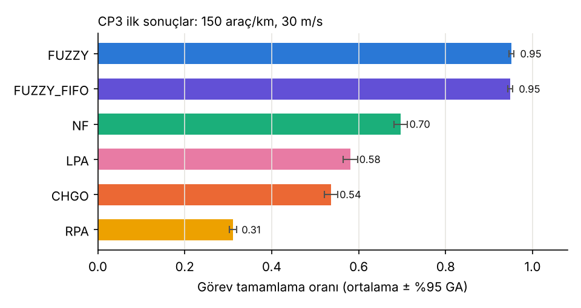
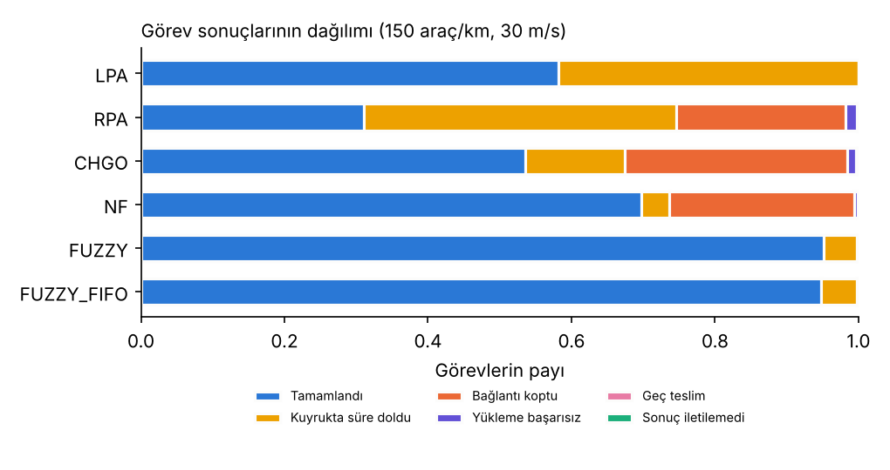

# Checkpoint 3 — Baseline Sistem ve İlk Sonuçlar (Gün 2)

Bu belge, Python simülatörünü, makaledeki denklemlerin koda nasıl aktarıldığını, makalede verilmediği için yaptığımız varsayımları ve ilk deney sonuçlarını özetler.

## 1. Ne yapıldı?

| Dosya | İçerik |
|---|---|
| `src/sim/config.py` | Tüm parametreler (`SimConfig`). Her satır MAKALE ya da VARSAYIM olarak etiketli. |
| `src/sim/mobility.py` | İki yönlü, 2+2 şeritli, 2 km'lik halka otoyol; araç hareketi; halka üzerinde mesafe; bağlantı kopma süresi (LET). |
| `src/sim/channel.py` | Nakagami-m başarı olasılığı (Denk. 1–2), yoğunluğa bağlı etkin hız ve çarpışma, parça bazlı ARQ ile veri aktarımı. |
| `src/sim/tasks.py` | Poisson görev üretimi (boyut, işlem yükü, öncelik, son teslim zamanı). Görevler yöntemden bağımsız üretilir. |
| `src/sim/policies.py` | LPA, RPA, CHGO, NF, FUZZY ve ablation amaçlı FUZZY_FIFO. |
| `src/sim/simulator.py` | Ayrık zamanlı ana döngü (Δt = 0,1 s), EN kuyrukları, metrikler. |
| `src/sim/experiment.py` | Paralel parametre taraması, ortalama ± %95 GA, grafik. |
| `experiments/baseline/cp3_first_results.py` | Tek senaryo, 6 yöntem, 10 seed. |
| `experiments/baseline/run_sweep.py` | E1 (yoğunluk) ve E2 (hız) deneyleri. |
| `tests/test_sim.py` | 23 test: denklem doğrulama, geometri, tekrar üretilebilirlik, sağlama kontrolleri. |

Toplam test: **26/26 geçiyor** (Gün 1'in 3 FIS testi dahil).

## 2. Bir görevin yaşam döngüsü

```
UN'de görev üretilir (boyut S, işlem yükü MI = 1500·S, öncelik p, son teslim D)
   │
   ├─ Edge seçimi (yönteme göre) ──► EN seçilir
   │
   ├─ Yükleme: S Mb, 1 Mb'lik parçalar, her parça p_başarı = P_Nakagami(d)·(1 − P_çarpışma)
   │           olasılıkla geçer, en fazla 4 yeniden iletim  → başarısız: "yükleme başarısız"
   │
   ├─ EN'ye varış: o an menzil dışındaysa → "bağlantı koptu"
   │
   ├─ EN kuyruğu: FIFO veya bulanık skor (FUZZY). Son teslime yetişemeyecek görev düşürülür
   │              → "kuyrukta süre doldu"
   │
   └─ İşlem biter → sonuç (0,05·S Mb) UN'ye gönderilir. Menzil dışı → "bağlantı koptu",
                    iletim başarısız → "sonuç iletilemedi", D aşıldı → "geç teslim",
                    aksi halde → TAMAMLANDI
```

## 3. Makaledeki denklemlerin koddaki karşılığı

| Makale | Kod | Not |
|---|---|---|
| Denk. 1: P = e^(−λr_T/Φ) Σ (λr_T/Φ)^k/k! | `channel.link_success_prob` | Toplam, düzenlenmiş üst eksik gamma fonksiyonuna eşittir: `gammaincc(m, m·r_T/Φ)`. Bu sayede Denk. 2'deki m = 1,5 için de tanımlı. Eşitlik testte doğrulandı. |
| Denk. 2: λ = 3 / 1,5 / 1 | `channel.nakagami_m` | 50 m ve 150 m eşikleri testte kontrol ediliyor. |
| Denk. 3: bağıl mesafe | `Highway.dist` | Halka üzerinde Öklid mesafesi. Adaylar arasındaki seçimde UN–aday mesafesi kullanılıyor (toplamın tek terimli hali). |
| Denk. 4: \|v_i − v_j\| | `Highway.rel_speed` | İşaretli hızlarla: karşı yönden gelen araç büyük bağıl hıza sahip olur. |
| Denk. 5–9: com_score = Σ w_x·MF_x, w_x = I_x/ΣI | `policies.FuzzySelect.scores` | Ayrıntı aşağıda. |
| Bölüm 2.2: "bağlantı süresi uzun + kaynak yeterli" | `Highway.link_expiration` + fizibilite filtresi | LET > tahmini toplam süre ve son teslim zamanına yetişen adaylar tercih edilir. |
| Bölüm 2.3: EN'de bulanık önceliklendirme | `Simulation._fuzzy_pick` | Gün 1 FIS'i (81 kural, Mamdani, centroid) EN kuyruğundaki tüm görevler için vektörlü çalıştırılır. |

### Edge seçiminin yorumu (FUZZY)
Makaledeki com_score'da boyut ve öncelik terimleri de var. Ancak bu iki değer belirli bir görev için tüm adaylarda aynıdır, yani hangi adayın seçileceğini değiştirmez. Bu yüzden bu iki terim, makaledeki gibi EN kuyruğundaki bulanık sıralamada kullanılıyor. Aday seçiminde ise şu dört üyelik derecesi kullanılıyor (hepsi 0–1):

| Terim | Hesap | Gerekçe |
|---|---|---|
| MF_dist | μ_low(d) + 0,5·μ_medium(d) — Gün 1 FIS'inin mesafe MF'leri | Yakın aday daha uzun süre menzilde kalır, kanal daha iyi |
| MF_speed | μ_low(Δv) + 0,5·μ_medium(Δv) — FIS'in hız MF'leri | Aynı yönde, benzer hızda giden aday |
| MF_cpu | poor / average / good → 0 / 0,5 / 1 | Şek. 4'teki MIPS terimleri |
| MF_load | 1 − (beacon'daki kuyruk beklemesi / kalan süre) | "Kaynak yeterli" koşulu |

Ağırlıklar eşittir (I_x makalede verilmemiş). Bu, mesafe ve hız MF'lerinin hem seçimde hem kuyrukta kullanıldığı anlamına geliyor. Gün 4'teki GA optimizasyonu bu iki aşamayı birlikte etkileyecek.

### Baseline'lar
| Yöntem | Uygulama |
|---|---|
| LPA | Görev UN'nin kendi işlemcisinde, FIFO |
| RPA | Menzildeki rastgele bir araç |
| CHGO | Merkezi denetleyici, 1 s'de bir güncellenen durum görüntüsüne bakarak (bekleme + işlem süresi) en küçük aracı seçer. Hareketlilik ve kanal kalitesini hesaba katmaz. |
| NF | Komşular MIPS'e göre azalan sırada dizilir. Son kullanılan EN'den başlayarak beklemesi < 2 s olan ilk aday seçilir. |
| FUZZY_FIFO | FUZZY ile aynı seçim, kuyruk FIFO. Bulanık kuyruğun katkısını ayırmak için eklendi (ablation). |

## 4. Varsayımlar ve kalibrasyon

### Neden bu sayılar?
İlk denemede (görev hızı 0,04/s/araç, 300 MI/Mb) 350 araç/km'de kanal tamamen doydu. Bu durumda tüm aktarım yöntemleri %10–17'ye düştü, LPA ise %97 ile en iyi çıktı. Bu sonuç makalenin temel varsayımıyla çelişiyor: makalede araçların kendi kaynağı yetersiz kabul ediliyor.

Bunun fiziksel sebebi şu: 350 araç/km'de 250 m menzilde yaklaşık 175 komşu var ve bunlar 4 servis kanalı × 6 Mbps = 24 Mbps'i paylaşıyor. Araç başına düşen pay çok küçük. Kanalı doyurmadan işlemcilerde anlamlı bir kuyruk oluşması için görevlerin **veri başına yoğun hesaplama** gerektirmesi gerekiyor (ör. görüntü işleme). Bu yüzden şu değerler seçildi:

| Parametre | Değer | Gerekçe |
|---|---|---|
| Görev hızı | 0,015 görev/s/araç | 350 araç/km'de kanal kullanımı ≈ %57: yüksek ama doymamış |
| Görev boyutu | U(0,5; 10) Mb | FIS evreniyle (0–10 Mb) aynı |
| İşlem yükü | 1500 MI/Mb | Ortalama görev: güçlü düğümde ~4 s, zayıf düğümde ~16 s |
| MIPS | 500 / 1000 / 2000, olasılıklar 0,5 / 0,35 / 0,15 | Araçların çoğu zayıf → aktarım gerekli (makalenin öncülü) |
| Son teslim | 3 + 1,0·S + 6·(1 − p) s | Büyük görev daha uzun sürer, acil görev daha az zaman alır |
| Yol kaybı | Φ/r_T = 2·(250/d)³ | 250 m'de m = 1 ile tek iletim başarısı ≈ %61 |
| Çarpışma | 1 − (1 − 0,002)^n | 175 komşuda ≈ %30 |
| CHGO güncelleme | 1 s | Merkezi kararın gecikmesi |
| Simülasyon | 300 s (ilk 20 s ısınma, son 30 s görev üretilmez) | Makalede 500 s; süre kısıtı |

Kalibrasyon yalnızca baseline davranışının makul olmasını hedefledi: kanal doymasın, yerel işlem yetersiz kalsın. FUZZY'nin iyi çıkması için ayar yapılmadı. Aynı parametrelerle bütün yöntemler aynı görevlerle koşuluyor (ortak rastgele sayılar, testte doğrulandı).

### Gecikme metriği
Yalnızca tamamlanan görevlerin gecikmesine bakmak, çok görev düşüren yöntemi yapay olarak iyi gösterir. Örneğin RPA zor görevleri düşürdüğü için kalan görevlerinin gecikmesi düşük çıkar. Bu yüzden ana metrik olarak **son teslim sınırlı gecikme** kullanıldı: tamamlanamayan görev, kendi son teslim süresi D kadar gecikmiş sayılır. Yalnızca tamamlananların gecikmesi de `avg_delay_completed` olarak raporlanıyor.

## 5. İlk sonuçlar (CP3)

**Tek senaryo:** 150 araç/km, 30 m/s, 10 seed (`results/tables/cp3_first_results_summary.md`)

| Yöntem | Tamamlama | Acil tamamlama | Gecikme (s) | Bağlantı kopması | Kuyrukta düşen |
|:--|:--|--:|:--|--:|--:|
| LPA | 0,581 ± 0,016 | 0,468 | 8,75 ± 0,13 | 0 | 0,419 |
| RPA | 0,311 ± 0,008 | 0,252 | 10,04 ± 0,08 | 0,236 | 0,435 |
| CHGO | 0,536 ± 0,015 | 0,495 | 8,59 ± 0,11 | 0,310 | 0,138 |
| NF | 0,697 ± 0,015 | 0,675 | 7,46 ± 0,13 | 0,258 | 0,039 |
| **FUZZY** | **0,951 ± 0,006** | **0,919** | **6,36 ± 0,14** | 0 | 0,046 |
| FUZZY_FIFO | 0,948 ± 0,005 | 0,900 | 6,35 ± 0,13 | 0 | 0,049 |




**E1 / E2 ön sonuçları (5 tekrar; Gün 3'te 30 tekrar koşulacak).** Tamamlama oranı:

| Yöntem | 50 | 100 | 150 | 200 | 250 | 300 | 350 araç/km |
|:--|--:|--:|--:|--:|--:|--:|--:|
| LPA | 0,580 | 0,579 | 0,580 | 0,584 | 0,578 | 0,574 | 0,576 |
| RPA | 0,339 | 0,320 | 0,302 | 0,307 | 0,280 | 0,277 | 0,248 |
| CHGO | 0,632 | 0,577 | 0,524 | 0,498 | 0,446 | 0,408 | 0,366 |
| NF | 0,693 | 0,706 | 0,700 | 0,703 | 0,675 | 0,675 | 0,656 |
| **FUZZY** | **0,928** | **0,953** | **0,951** | **0,930** | **0,907** | **0,882** | **0,828** |

| Yöntem | 10 | 20 | 30 | 40 | 50 m/s |
|:--|--:|--:|--:|--:|--:|
| LPA | 0,580 | 0,580 | 0,580 | 0,580 | 0,580 |
| RPA | 0,413 | 0,348 | 0,302 | 0,286 | 0,276 |
| CHGO | 0,697 | 0,609 | 0,524 | 0,497 | 0,476 |
| NF | 0,888 | 0,775 | 0,700 | 0,656 | 0,633 |
| **FUZZY** | **0,952** | **0,952** | **0,951** | **0,949** | **0,949** |

Grafikler: `results/figures/e1_density_*_r5.png`, `e2_speed_*_r5.png`.

## 6. Makaleyle eğilim karşılaştırması

| Makaledeki gözlem | Bizde | Durum |
|---|---|---|
| Önerilen yöntem tüm yoğunluklarda en düşük gecikme (Şek. 9) | Evet, 7 noktanın hepsinde | ✅ |
| Önerilen yöntem tüm yoğunluk ve hızlarda en yüksek tamamlama (Şek. 11–12) | Evet, 12 noktanın hepsinde | ✅ |
| Yoğunluk ↑ → gecikme ↑ | FUZZY, NF, CHGO, RPA'da evet (FUZZY'de 50→100 arasında küçük düşüş var) | ✅ (kısmen) |
| CHGO hızlara karşı tutarlı, yoğun ağda zayıf | Yoğunlukta zayıflıyor ✅. Hızda ise düşüyor (0,70 → 0,48) ❌ | Kısmen |
| NF yoğun bölgelerde güçlü | NF yoğunlukta en kararlı baseline | ✅ |
| LPA en kötü | Bizde **RPA** en kötü, LPA ikinci en kötü | ❌ |
| Yüksek yoğunlukta RPA > LPA | Hayır | ❌ |

**Uyumsuzlukların olası nedenleri (raporun tartışma bölümü için):**
1. **RPA'nın kötülüğü:** Bizde araçların %50'si zayıf düğüm. Rastgele seçim çoğunlukla bu düğümlere ve karşı yönden gelen araçlara denk geliyor. Makaledeki kaynak dağılımı verilmediği için daha homojen bir dağılım kullanılmış olabilir.
2. **LPA'nın sabitliği:** Bizim modelimizde yerel işlem kanal kullanmadığı için yoğunluk ve hızdan etkilenmiyor. Makalede LPA'nın da kötüleşmesi, araç üstü kaynak paylaşımı gibi modellenmemiş bir etkiden kaynaklanıyor olabilir.
3. **CHGO ve hız:** Bizim CHGO'muz hareketliliği hiç dikkate almıyor. Bu yüzden hız arttıkça bağlantı kopmaları artıyor (%13 → %38).

## 7. Bulgular ve Gün 3–4'e etkisi

- **FUZZY'nin üstünlüğü büyük ölçüde edge seçiminden geliyor.** LET filtresi bağlantı kopmalarını neredeyse sıfıra indiriyor; yük terimi de görevlerin zayıf veya dolu düğümlere gitmesini engelliyor. Bu yüzden FUZZY hızdan neredeyse hiç etkilenmiyor.
- **Bulanık kuyruğun katkısı küçük ama ölçülebilir.** FUZZY ile FUZZY_FIFO'nun genel tamamlama oranları aynı (fark < 0,005). Acil görevlerde ise fark var ve yük arttıkça büyüyor (100 araç/km, 5 seed):

  | Görev hızı | FUZZY acil | FUZZY_FIFO acil | Fark |
  |---|---|---|---|
  | 0,015 | 0,919 | 0,908 | +0,011 |
  | 0,025 | 0,858 | 0,847 | +0,011 |
  | 0,035 | 0,771 | 0,727 | +0,044 |

  Nedeni: kuyruk ortalama 0,5 s bekleme ile kısa kalıyor, sıralama nadiren fark yaratıyor. Yük arttıkça bulanık sıralama acil görevleri öne alarak kurtarıyor.
- **Özgün katkı için sonuç:** GA ile MF optimizasyonu (16 gen) hem seçimi (mesafe ve hız MF'leri) hem kuyruğu etkiliyor. GA'nın etkisini daha net ölçmek için Gün 4'te **yüksek yük senaryosu** (görev hızı 0,035) ayrıca test edilmeli. Fitness'a acil görev tamamlama oranı da eklenebilir.
- **Hesap maliyeti:** FIS değerlendirmesi görev başına ≈ 0,14 ms (NumPy, vektörlü). Bir koşu 1–3 s sürüyor; 30 tekrarlı E1 2 çekirdekte yaklaşık 4 dakika.

## 8. Sınırlılıklar (bu aşama)
- SUMO'nun kent haritası yerine halka otoyol kullanıldı. Kavşak, şerit değiştirme ve trafik ışığı yok.
- 802.11p MAC paket düzeyinde değil, analitik olarak modellendi (beklenen kanal kullanımı + çarpışma olasılığı).
- Görev, işlem ve son teslim parametreleri makalede yok; kalibrasyonla seçildi (Bölüm 4).
- PDR (Şek. 10) ve araç başına beacon sayısı henüz ölçülmedi.
- Sonuçlar 5 tekrarlı ön sonuçlardır.

## 9. Çalıştırma
```bash
python -m pytest -q                                         # 26 test
python -m experiments.baseline.cp3_first_results            # ~10 s
python -m experiments.baseline.run_sweep --exp density --reps 5
python -m experiments.baseline.run_sweep --exp speed --reps 5
```
